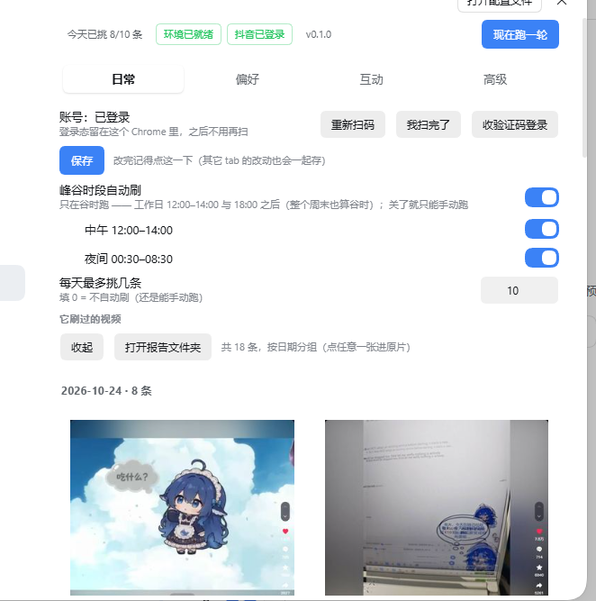
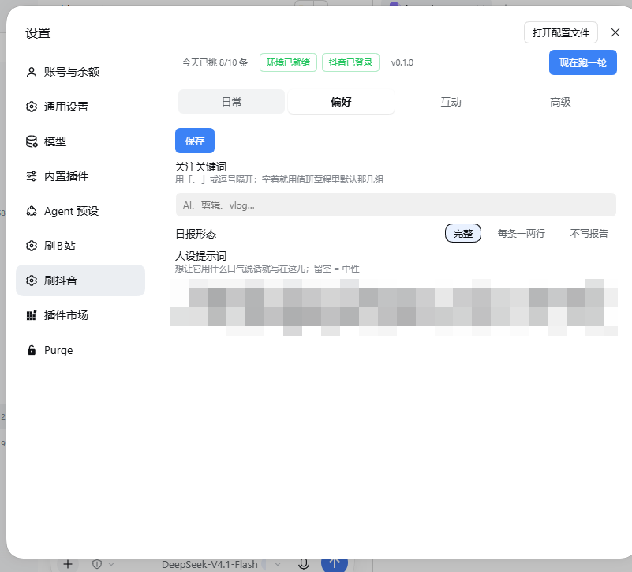
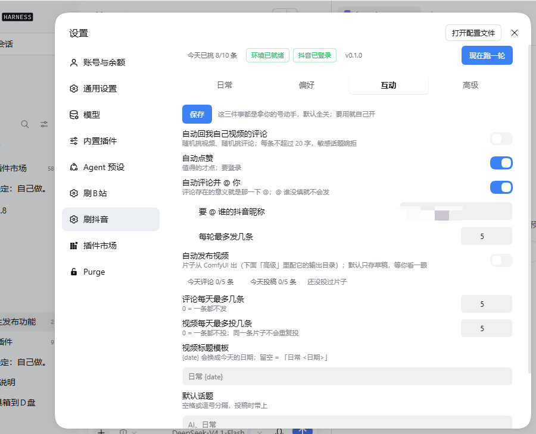
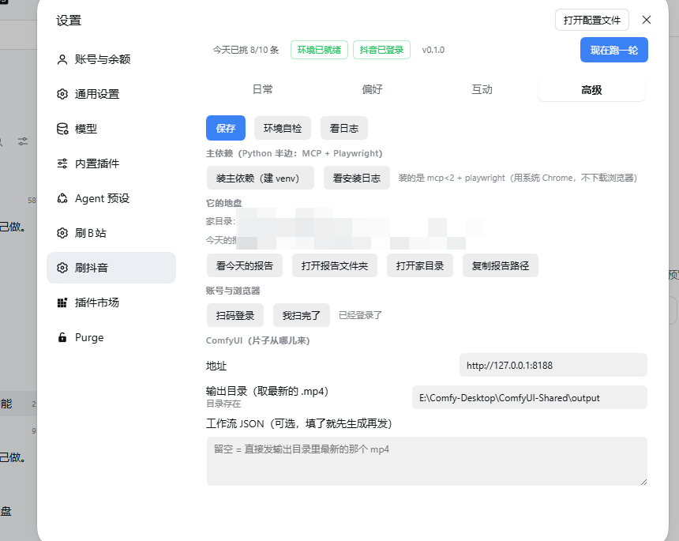

<p align="center"></p>

<h1 align="center">刷抖音 · dsh-douyin-life</h1>

<p align="center">每天替你刷一轮抖音：挑片、读评论、写日报；值得的点赞、评论并 @ 你；片子那头接你自己的 ComfyUI。</p>

---

## 它是干什么的

装进 DeepSeek Harness 之后，设置里多出一个「刷抖音」页面，和一个会自己干活的「值班」：

- **刷一轮**：按你的高峰/谷时窗口挑几条视频，读标题、字幕、评论区，挑出**值得看**的（不是按播放量排）；
- **写日报**：每条带链接、时长、点赞/评论数、一句话「为什么值得」；按日期分文件，页面里直接看，不用打开文件；
- **动手（默认关）**：点赞、评论并 @ 你、投稿视频——三个闸门各自独立，你开了它才动，做完在日报里如实写结果（失败也写）；
- **回自己视频的评论**：**只回当天发布的视频**（过了当天就不碰），随机挑评论，每条不超过 20 字；敏感话题换成委婉拒绝；
- **出片**：接你本机的 ComfyUI，把输出目录里最新的成片发到抖音（默认只存草稿）。

它不碰你的密码：登录态留在插件自己的浏览器 profile 里，扫码一次就行。

## 界面

### 日常 —— 什么时候跑、跑几条、它刷过什么



- 节假日/周末全算谷时；关了自动跑也能「现在跑一轮」；
- 「它刷过的视频」按日期分组，卡片是**真截图**（抖音封面链接会过期，所以本地截播放器画面），点进去是原片。

### 偏好 —— 关注什么、用什么口吻



- **关注关键词**：留空就用章程里的默认几组（AI / 剪辑 / vlog …）；
- **日报形态**：完整 / 每条一两行 / 不写文件；
- **人设提示词**：它写日报、挑片的口吻。留空 = 中性；写「自由、调皮、不循规蹈矩」它就真的是那个腔调。

### 互动 —— 拿号动手的三件事 + 回评论



- **自动回我自己视频的评论**：随机读，条数可调（每次几条 / 每天最多回几条），回过的不会重复回；
- **自动点赞 / 自动评论并 @ 你 / 自动发布视频**：默认**全关**，开了才有上限（每天几条）；
- 评论那条的意义就是那一下 `@`——没填「要 @ 谁」就不会发。

### 高级 —— 依赖、家目录、浏览器、ComfyUI



- **装主依赖**：建独立 venv 装 `mcp` + `playwright`（用系统 Chrome，不下载浏览器）；
- **它的地盘**：家目录、今天的报告、打开报告文件夹/家目录/复制路径；
- **账号与浏览器**：扫码登录、我扫完了；要短信验证时点「收验证码登录」；
- **ComfyUI**：地址、输出目录（取最新的 `.mp4`）、可选工作流 JSON（填了就先生成再发）。

## 安装

从源码目录挂进 profile（开发用）：

```bash
dsh plugin --profile desktop add link:D:/path/to/dsh-douyin-life
```

之后**重启一次 dsh** 才会加载（设置页是启动时组装的）。插件自带 `cordis.patch.yml`，`package.json` 里声明了 `dsh.bundle.patch`，`dsh plugin add` 直接认。

首次使用：设置 → 刷抖音 → 高级 → **装主依赖**（几分钟，进度看安装日志）→ 日常 → **扫码登录**。

## 它在哪、放在哪

| 东西 | 位置 |
|---|---|
| 家目录 | `%USERPROFILE%\.dsh\douyin-duty` |
| 配置 | `<家>/config.json`（面板里改就是改这个） |
| 日报 | `<家>/out/YYYY-MM-DD.md` |
| 缩略图缓存 | `<家>/thumbs/<视频id>.jpg` |
| 记忆 | `<家>/memory/YYYY-MM.md` |
| 登录态 | `<家>/browser/`（Playwright 持久化 profile） |

## 工具（25 个 `dy_*`）

读：`dy_status` `dy_whoami` `dy_hot` `dy_hot_videos` `dy_search` `dy_video` `dy_comments` `dy_my_posts`（今天发过哪些）`dy_my_videos` `dy_comfy_list`
写（有闸门）：`dy_like` `dy_comment` `dy_reply` `dy_reply_round` `dy_publish`
其它：`dy_config` `dy_login_start` `dy_login_poll` `dy_login_sms` `dy_login_sms_submit` `dy_remember` `dy_thumb` `dy_run` `dy_selfcheck` `dy_chrome_open`

## 说明

- 视频内容默认标注「内容由AI生成」（抖音发布时会自动勾「自主声明」，B站投稿脚本会勾「含AI生成内容」）；
- 登录态、日报、缩略图都留在**你本机**，不进仓库；
- 这个仓库只是插件本体；`node_modules` / `.venv` / 日志都在 `.gitignore` 里。

## License

MIT
