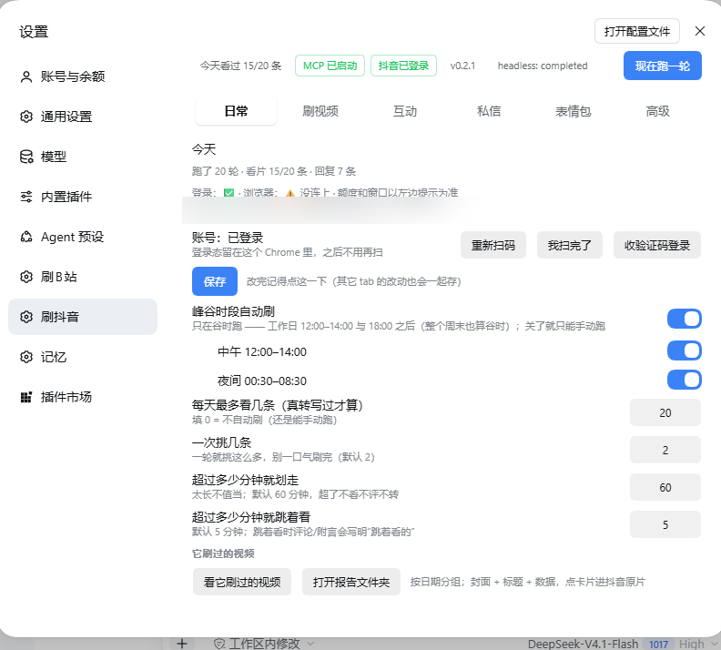
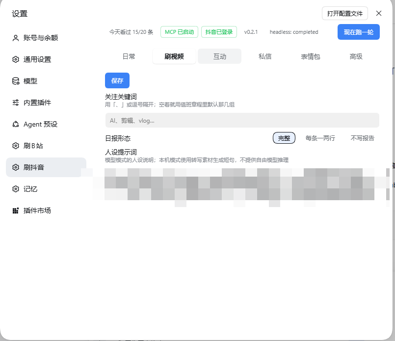
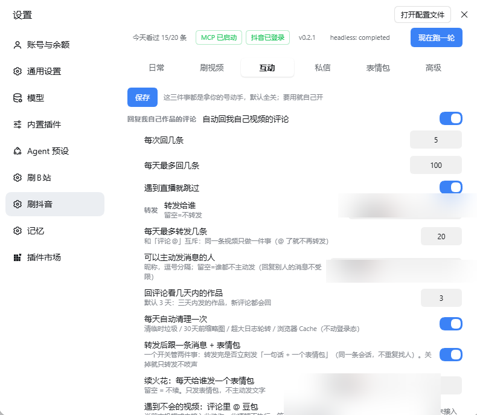
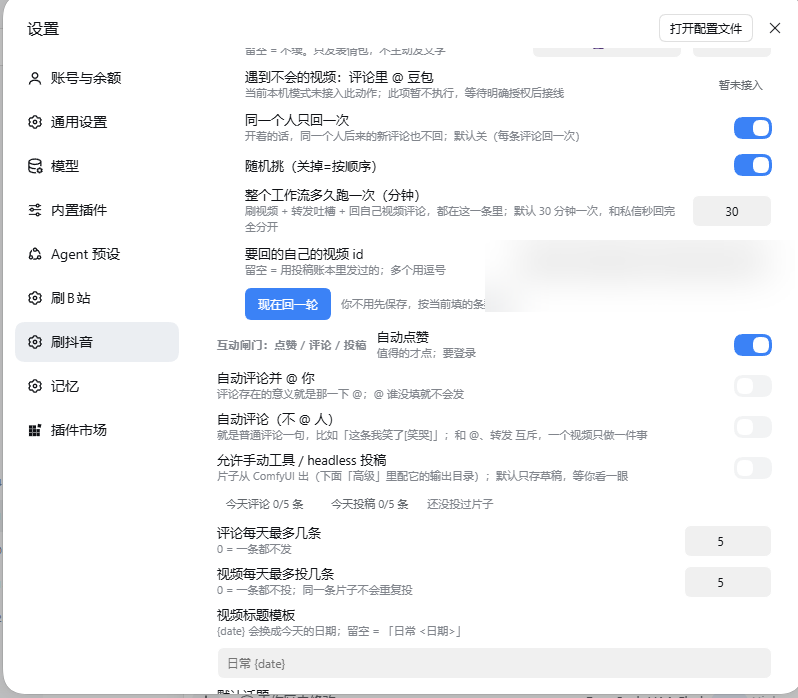
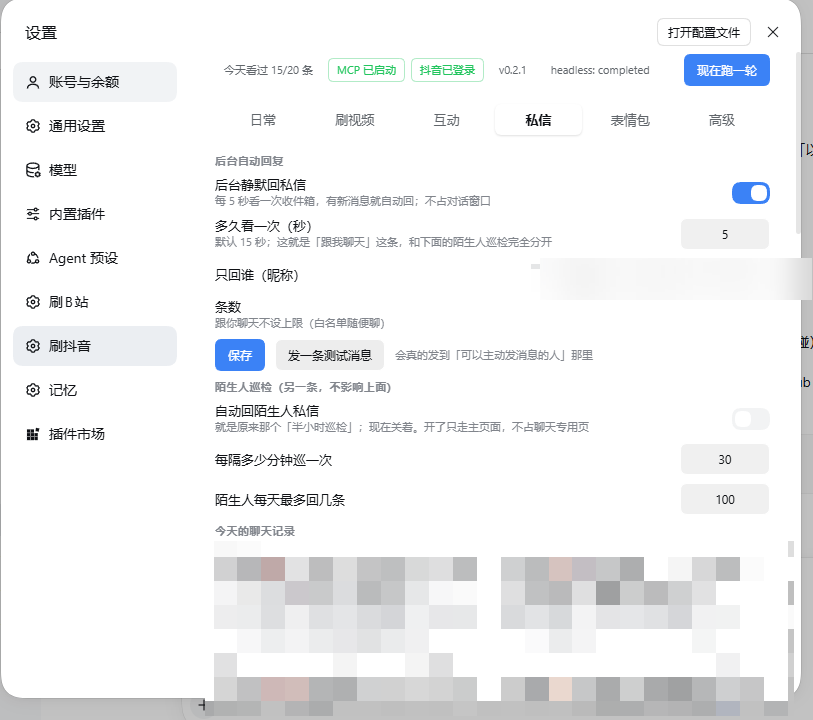
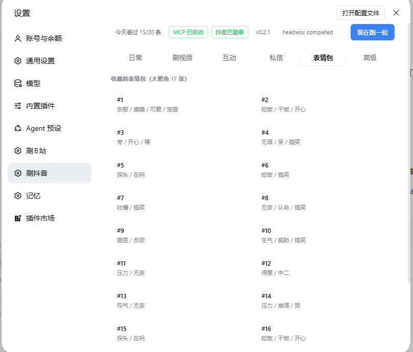
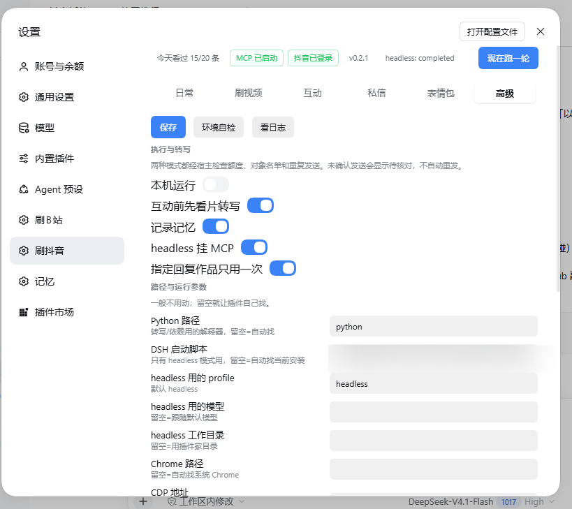
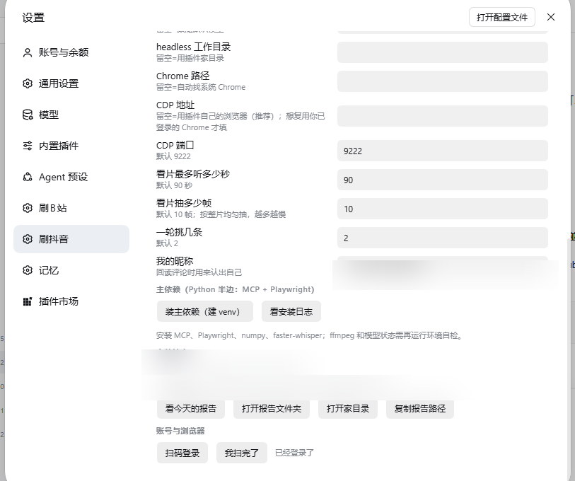

# dsh-douyin-life（刷抖音）

> DSH 插件。每天替使用者刷抖音：**刷推荐流 → 看片（转写）→ 读评论 → 挑片写日报**，
> 顺手做点赞、评论（可 @ 你）、转发视频给你（附一句话 + 一个对味表情包）、续火花、回私信（含陌生人）；
> 另一头接他自己的 **ComfyUI** 出片，把成片发到抖音。

**装法**：从插件市场 / 源码目录 link 进 profile（**npm 包 0.2.1 尚未发布，公开 npm 查询是 404，先别用 `dsh plugin add dsh-douyin-life`**）。设置页有「刷抖音」一页（**日常 / 刷视频 / 互动 / 私信 / 表情包 / 高级** 六个 tab），左侧还有「记忆」一页（**插件自带**记忆 `<家>/memory/*.md` + 人设 `persona.md`，不依赖任何记忆插件）。


接口契约见 [`SPEC.md`](./SPEC.md)。发布说明见 [`PUBLISH.md`](./PUBLISH.md)。

## 第一次用：把这份交给你的 agent

装好后别自己在设置页瞎点。把下面这句发给你的 AI：

> 读一下 `dsh-douyin-life` 的 `docs/AGENT_ONBOARDING.md`（在你本机 DSH 的插件目录 `node_modules/dsh-douyin-life/docs/` 里），按它把登录、记忆/人设、私信和表情包配好。

那份文档是**写给 agent 看的**：Chrome 怎么检测/安装/自动打开、扫码和短信验证码怎么登、
默认记忆/人设怎么用（不用装记忆插件）、收藏表情包怎么巡检、没有收藏时怎么用关键字兜底、
哪些写动作默认关着不许碰、出问题怎么排查。

---

## 界面

设置页在 **DSH → 设置 → 刷抖音**，六个 tab：日常 / 刷视频 / 互动 / 私信 / 表情包 / 高级。

> **记忆和人设是插件自带的，不依赖任何记忆插件**：默认记忆写在 `<家>/memory/YYYY-MM.md`，
> 人设是 `<家>/persona.md`（+ `personaPrompt`），下一轮开头会带上最近记忆。
> 需要的话可以接入你自己的记忆系统（见 [`docs/AGENT_ONBOARDING.md`](./docs/AGENT_ONBOARDING.md) 的「记忆与人设」一节）；
> 不接也完全不影响使用。

### 日常


### 刷视频


### 互动




### 私信


### 表情包


### 高级




## 1. 装

```bash
# ① 插件市场（推荐）：DSH → 插件 → 搜「刷抖音」→ 安装
# ② npm（0.2.1 尚未发布，先别用；发布后才是 dsh plugin --profile desktop add dsh-douyin-life）
# ③ 源码目录（当前可用）
dsh plugin --profile desktop add link:D:/jev-decision-kit/plugins/dsh-douyin-life
# 之后重启一次 dsh 才生效
```

首次启用后**默认走插件自己的浏览器 profile**：直接 `dy_login_start` 出二维码 / `dy_login_sms` 短信登录即可，第一次扫一次码，
之后登录态一直留在本机。想复用「本人日常已登录的 Chrome」才调 `dy_chrome_open`（它会拉起带调试端口的 Chrome 并把 `cdpUrl` 切到 CDP 模式）。
完整步骤见 [`docs/AGENT_ONBOARDING.md`](docs/AGENT_ONBOARDING.md)。登录态只落在本机，不上传任何地方。

**「高级」页可以一键把运行环境装好**：`装主依赖（建 venv）` → 装 `mcp<2 + playwright + numpy + faster-whisper + httpx + pillow`（用系统 Chrome，不下载浏览器）→ `环境自检`。
视频理解原型 `video-understanding-lab/` 随插件包一起发（`dy_watch` 用），缺了会在自检里明确报出来。

---

## 2. 家目录

`%USERPROFILE%\.dsh\douyin-duty\`（或 `$DSH_HOME/douyin-duty/`）

| 文件 / 目录 | 说明 |
|---|---|
| `config.json` | 插件自己那份配置（面板/工具写） |
| `state.json` | `{day,count,picked,loggedIn,windows,winTries,commentFails,...}` |
| `duty.log` | 一行一件事（每次工具调用、每轮结果都有一行） |
| `out/YYYY-MM-DD.md` | 每轮日报（按 `### <视频id>` 记） |
| `ledger.json` | 账本：回过的评论 cid、发过的评论、转发过的视频、私信次数 |
| `memory/YYYY-MM.md` | **默认记忆**（视频观察、私信对话、续火花…） |
| `persona.md` | 人设（手写正文 + 每天自动补的「最近观察」段） |
| `dm-log/YYYY-MM-DD.json` | 私信聊天记录（谁、说了什么、回没回） |
| `.need-captcha` | 验证码标记：有它时浏览器切「带界面」 |
| `replied-cids.txt` / `replied-users.txt` | 去重索引（评论 cid / 已回过的用户） |
| `thumbs/` | 缩略图（卡片用，30 天自动清） |
| `media/` | 看片时抽的音轨 + 转写缓存 `*.json`（音轨每天清，json 留着省得重下） |
| `duty.md` | 值班章程（用户改过就保留，新版落 `duty.md.new`） |
| `persona.md` | 人设（`personaPrompt` 也在这里） |
| `mcp_server.py` | Python MCP（从 `vendor/` 铺过来） |
| `browser/` | Playwright 持久化 profile（登录态在这里） |
| `.venv/` | Python 依赖环境（`pythonPath` 指过来） |
| `headless-overlay.yml` | 跑一轮时临时叠给 headless 的 patch |

> ⚠️ 凭证 / 登录态 / 报告一律落在家里，绝不写进插件包（装进 `node_modules` 后只读、升级会覆盖）。

---

## 3. 工具（35 个 `dy_*`）

### 读 / 看
| 工具 | 干什么 |
|---|---|
| `dy_status` | 今天跑没跑、挑了几条、额度、窗口、登录态、CDP、报告路径 |
| `dy_config` | 读 / 改配置（不给 `patch` 就是读） |
| `dy_whoami` | 抖音登录的是谁 |
| `dy_feed` | **刷推荐流**（打开精选→点推荐→拦 `/module/feed/`），不搜索 |
| `dy_hot` / `dy_hot_videos` | 热榜 / 某热点下的视频（不用登录） |
| `dy_search` | 关键词搜视频 |
| `dy_video` | 单条视频信息（标题/作者/时长/点赞） |
| `dy_comments` | 评论（接口优先，**图文作品直接 DOM 抠**；不编数据） |
| `dy_my_posts` / `dy_my_videos` | 我自己发的作品（按天过滤）/ 投稿账本 |
| `dy_thumb` | 给视频截缩略图 |
| `dy_comfy_list` | 列 ComfyUI 输出目录里最近的 `.mp4` |
| `dy_remember` | 往 `<家>/memory/YYYY-MM.md` 记一行 |

### 动手（都有闸门）
| 工具 | 干什么 | 闸门 |
|---|---|---|
| `dy_like` | 点赞 / 取消 | `autoLike` 或 `force: true` |
| `dy_comment` | 发评论 / 回复（可 `mention` 真人 @；图文作品用 `reply_index` 按序号回） | `autoComment`+`mentionName` / `autoCommentPlain`，或 `force: true` |
| `dy_share` | **转发视频给某人**（悬停出分享面板→点那行的「分享」），随后同一会话发「一句话 + 一个表情包」 | 名字在「可以主动发消息的人」里，或 `force: true` |
| `dy_chat_send` | 私信发一句（续火花用） | 同上 |
| `dy_chat_sticker` | 私信发表情包（关键词联想，可 `flip` 换一批） | 同上 |
| `dy_dm_inbox` | **只读**私信收件箱（谁发的、内容预览） | — |
| `dy_dm_poll` | 手动跑一次后台秒回巡检（有新的就回一句） | `dmAutoReply` |
| `dy_dm_round` | 旧的「看一遍私信回一句」：模板短句 + 每日额度 | `dmReply` |
| `dy_reply_round` | 回我自己视频下的新评论 | `autoReply` |
| `dy_reply` | 回复某一条指定评论 | `autoReply` |
| `dy_publish` | 投稿（`video_path` 或 `latest: true`）；自动勾「内容由 AI 生成」，默认存草稿 | `autoPublish` 或 `force: true` |

### 维护
| 工具 | 干什么 |
|---|---|
| `dy_run` | 立刻跑一轮（默认**本机直跑**，不 spawn headless；`mode: "headless"` 才起子会话） |
| `dy_selfcheck` | 真跑一次环境自检（家目录 / Python / MCP / ComfyUI + 一次登录检查） |
| `dy_cleanup` | 立刻清一次：临时垃圾、老缩略图、老日报、日志轮转、媒体音轨、浏览器 Cache |
| `dy_chrome_open` | 把「本人已登录的 Chrome」拉起来并开 CDP 端口（之后所有动作都走它） |
| `dy_login_start` / `dy_login_poll` | 扫码登录 |
| `dy_login_sms` / `dy_login_sms_submit` | 短信验证码登录 |

---

## 4. 一轮到底做了什么

```
谷时窗口（或手动「现在跑一轮」）
└─ dy_feed 刷一屏推荐（不搜索）
   └─ 按时长筛：> 划走阈值 直接跳过；> 跳着看阈值 标记 skim
      └─ 打分排序 → 一轮只挑「一次挑几条」
         └─ 动作轮转（保证一轮里既有转发也有评论，一条视频只做一件事）：
            · 评论 @ 你        （每天限额 commentPerDay）
            · 普通评论（不@）   （每天限额 plainCommentPerDay）
            · 转发给某人        （每天限额 sharePerDay → 分享 + 一句话 + 一个表情包，同一会话）
            · 只点赞
         └─ 要「动手」的那几条先真看片：dy_watch 抽音轨 → faster-whisper 转写
   └─ 写日报 out/YYYY-MM-DD.md（### <视频id> + 标题/作者/数据/为什么）
   └─ 动作结果（成功/失败原因）也写进日报，不假装成功
```

**另一个定时器**（`每隔多少分钟看一次评论和私信`，默认 30 分钟、±20% 抖动）到点会：

1. 续火花（每天 1 次）
2. 看私信 → 谁发来新消息就回一句（每人 1 条/天、合计 5 条/天）
3. 看评论 → 回我自己视频下的新评论（`回评论看几天内的作品`，默认 3 天）

---

## 5. 看片（真转写）

- 走随包发布的 `video-understanding-lab/`：`capture`（用浏览器 cookie 下载）→ `prepare`（抽帧 + 16k 单声道）→ `asr`（faster-whisper）→ `transcript.json`；
- `watchSeconds` 是**硬预算**：传给 `prepare --limit-seconds`，只分析前 N 秒，返回 `partial=true`、`duration` 为实际分析时长；
- 转写缓存 `media/<id>.<秒数>.v4.json`（旧 v3 缓存一律忽略并重跑；避免读到 duration=0 的坏缓存）；模型缓存放 `<家>/models`；`DOUYIN_WHISPER_MODEL` 可选 `tiny/base/small`；
- 首次转写：缓存里没有模型时会自动按 `HF_ENDPOINT`（默认 hf-mirror）下载；要强制离线就设 `DOUYIN_WHISPER_OFFLINE=1`；
- `video-understanding-lab/` 随 npm 包发布；也可用 `DOUYIN_VIDEO_LAB` 指向别的原型目录；缺 `run.py` 时 `dy_watch` 明确报「未安装」，依赖看片的评论/转发会跳过；
- 依赖：`ffmpeg`（系统安装）+ Python 包里的 `faster-whisper` / `numpy` / `pillow` / `playwright`。

**已知限制（实测）**

| 情况 | 结果 |
|---|---|
| 普通短视频 | 能看片；只转写前 `watchSeconds` 秒，长片会标 `partial=true` |
| 长视频 / 大文件 | 不再整条下载；按预算截断转写，超出 256MiB 的原型预算会明确失败 |
| 图文作品（note） | 评论接口不抛数据 ⇒ **直接 DOM 抠**；「回复某条评论」入口点不到，暂不支持回复 |
| 短视频评论 | 桌面端没有发送按钮，**回车即发**；发完会**回读确认**，确认不到就算失败（不误报成功） |
| 缺 lab / ffmpeg / 模型 | `dy_watch` 返回明确原因；不会谎称「看过了」 |

---

## 6. 设置字段（六个 tab）

### 日常
| 字段 | 默认 | 说明 |
|---|---|---|
| `perDay` | 5 | 每天最多挑几条（0 = 不自动刷；手动「现在跑一轮」仍可跑一轮） |
| `peakValley` / `noon` / `night` | false / true / true | 谷时自动刷总开关（默认关）/ 中午 12–14 / 夜间 00:30–08:30 |
| `pickPerRound` | 2 | 一次挑几条（别一口气刷完） |
| `skipOverMin` | 60 | 超过多少分钟就划走 |
| `skimOverMin` | 5 | 超过多少分钟就跳着看（评论/附言会写明） |

### 偏好
| 字段 | 默认 | 说明 |
|---|---|---|
| `keywords` | `[]` | 关注关键词（空 = 用章程默认） |
| `reportLevel` | full | `full` / `brief` / `off` |
| `personaPrompt` | `''` | 人设提示词（决定它怎么说话） |
| `memory` | true | 是否写记忆 |

### 互动
| 字段 | 默认 | 说明 |
|---|---|---|
| `autoReply` | false | 自动回我自己视频下的评论 |
| `replyPerRun` / `replyPerDay` | 3 / 10 | 每次回几条 / 每天最多 |
| `replyRandom` | true | 随机挑（关 = 按顺序） |
| `replyOncePerUser` | false | 同一个人只回一次 |
| `replyIntervalMin` | 30 | 每隔多少分钟看一次**评论和私信**（±20% 抖动） |
| `replyVideoIds` | `''` | 要回的自己的视频 id（一次性/长期看 `replyOneShot`） |
| `replyWorksDays` | 3 | 回评论看几天内的作品 |
| `skipLive` | true | 遇到直播就跳过 |
| `autoLike` | false | 自动点赞 |
| `autoComment` + `mentionName` | false / `''` | 评论并 @ 你 |
| `commentPerDay` | 10 | 每天最多几条 @ 评论 |
| `autoCommentPlain` / `plainCommentPerDay` | false / 10 | 自动评论（**不 @ 人**）/ 每天最多几条 |
| `shareToNick` / `sharePerDay` | `''` / 10 | 转发给谁 / 每天最多转发几条（与评论互斥） |
| `shareNote` | `''` | 转发时附带的一句话（空 = 按看片内容/类型自动生成） |
| `msgAllowTo` | `''` | **可以主动发消息的人**（昵称逗号分隔；空 = 谁都不主动发） |
| `dmReplyOnlyTo` | `''` | **只回谁的私信**（昵称，逗号分隔，可多人；空 = 谁发来都回） |
| `dmReply` | false | 自动回**陌生人**私信（模板短句） |
| `dmAutoReply` / `dmAutoIntervalSec` | true / 15 | 后台秒回**白名单**私信 / 多少秒看一次；只有收到平台确认的发送才记为已回复 |
| `dmReplyPerContact` / `dmReplyPerDay` | 1 / 5 | 每个联系人每天回几条 / 每天合计 |
| `streakNick` / `streakPerDay` | `''` / 1 | 续火花发给谁 / 每天几次 |
| `askDoubao` | false | 遇到不会的视频在评论里 @ 豆包 求解答 |
| `autoPublish` / `publishPerDay` | false / 1 | 自动投稿 / 每天最多投几条 |
| `publishTitle` / `publishTags` | `''` | 标题模板（`{date}` 会替换）/ 默认话题 |
| `publishDraft` | true | 投稿默认存草稿 |

### 高级
| 字段 | 默认 | 说明 |
|---|---|---|
| `localRound` | true | 「跑一轮」用本机直跑（不 spawn headless） |
| `watchBeforeAct` / `watchSeconds` | true / 90 | 动手前先真看片 / 最多听前多少秒 |
| `autoClean` | true | 每天自动清理一次 |
| `pythonPath` | `python` | `pythonPath` → `.venv` → `uv` → `python` |
| `cdpUrl` / `cdpPort` / `chromePath` | `''` / 9222 / `''` | 默认 `''` 用插件自己的 profile；填地址才复用「本人已登录的 Chrome」 |
| `headlessProfile` / `headlessModel` / `overlayMcp` / `workspace` | headless / `''` / true / `''` | 起子会话时的参数 |
| `dshBin` | `''` | dsh 的 bin.js（空 = 自动探测，含 `app.asar` 路径） |
| `comfyUrl` / `comfyOutputDir` | `127.0.0.1:8188` / ComfyUI output | ComfyUI 地址 / 成片目录 |
| `comfyWorkflow` / `comfyWaitSeconds` / `comfyListLimit` | `''` / 900 / 20 | 可选工作流 / 等出片上限 / 列表条数 |

> 每个字段都带 `.extra('volatile', true)`（否则 `settings.update()` 报 `has no volatile fields`）。
> **新增字段必须同时改四处**：`Config`（schema）、`DEFAULTS`、`clampPatch`、`client.js` 的 load/save，
> 少一处就是「填了没用」——`selfcheck.mjs` 有断言盯着这件事。

---

## 7. HTTP（设置页用）

| 方法 | 路径 | 说明 |
|---|---|---|
| GET | `/api/douyin-duty/status` | 状态（config / windows / nextWindow / gates / cdp / doing） |
| GET / POST | `/api/douyin-duty/config` | 读 / 写配置 |
| POST | `/api/douyin-duty/run` | 立刻跑一轮（默认本机直跑；返回 `picked` / `actions` / `error`） |
| GET | `/api/douyin-duty/thumb?id=` | 缩略图（没有就现截） |
| GET | `/api/douyin-duty/watched` | 刷过的视频（按日期分组，卡片用） |
| GET | `/api/douyin-duty/report/latest` | 最近一份日报 |
| POST | `/api/douyin-duty/login/qr` · `/login/poll` | 扫码登录 |

---

## 8. 环境问题怎么降级

| 情况 | 表现 |
|---|---|
| headless 子进程写系统 Temp 被拒（`EPERM mkdtemp`） | 插件把 `TEMP/TMP/TMPDIR` 指到 `<家>/.tmp`；MCP 子进程也带同样变量 |
| 沙箱不让子进程开命名管道（Playwright `WinError 5`） | 跑一轮时给子进程 `DSH_SANDBOX=danger-full-access`；跑不动就退回**本机直跑**（`localRound`） |
| Chrome 没带调试端口 | `dy_status.cdp.ok=false` + 提示；`dy_chrome_open` 拉起来 |
| MCP 起不来 / Python 缺 | 工具返回 `{ok:false, error, hint}`，**不抛异常** |
| 抖音没登录 | `{ok:false, needLogin:true, hint}` |
| 评论发不出去 | **回读确认**不到就报失败；连续失败 2 次当轮停止评论（点赞/转发照做） |
| ComfyUI 目录不存在 / 出片超时 | `dy_comfy_list` 给 `exists:false`；`dy_publish` 给 `ok:false` + 怎么改 |
| 设置 → 记忆 报「读取失败 / 读取不到记忆」（0.2.0 及更早） | 那几版把 图谱 / 角色卡 / 时间线 当成「记忆系统」插件的功能却直接去调 `memory.*`，没装就报错。**0.2.1 起：没装可选记忆插件就自动退回本地 `memory/*.md` + 人设，不再报错**。更新后重启一次 dsh |

加载路径每一步都包 `try/catch`：**插件加载失败比少个功能糟得多**。

---

## 9. 自检

```bash
node selfcheck.mjs      # 56 条断言：宿主能加载 / 工具齐（35 个）/ 路由通 / 结构对 / 闸门默认关 / 视频理解原型在位
```

**验收边界（别把「装上了」当「全通了」）**

- 已用离线/本地方式验证：宿主加载、工具注册、HTTP 路由、六页 UI 可切换、只读工具（热榜/推荐/详情/评论/缩略图）、闸门关闭时的拒绝、记忆降级、看片原型入口与依赖检查；
- **未做真实账号验收**：点赞 / 评论 / 私信发送 / 转发的平台回执、真实视频的看片转写、登录后的搜索与个人作品读取；这些需要测试账号和联网环境，报告里不写「已通过」；
- 看片还需要本机 `ffmpeg` + faster-whisper 模型（首次会下载）；未登录也能用热榜/详情/评论（只读）。

---

## 10. 最近更新（0.2.1 修复补丁 · 2026-10-27）

- **新装默认 profile 模式**（`cdpUrl` 空）：不用先开 Chrome/调试端口；显式 CDP 连不上会自动退回 profile；想复用日常 Chrome 才调 `dy_chrome_open`（会切 CDP）。
- **看片模块随包发布**：`video-understanding-lab/` 进 npm files/仓库，宿主通过 `DOUYIN_VIDEO_LAB` 指路；`watchSeconds` 传进 `prepare --limit-seconds` 真正截断，返回 `partial`。
- **私信不再假成功**：只有平台确认的发送才记 `replied=true`；否则 `unknown` 且最多重试一次。秒回目标 = `msgAllowTo` 按 `dmReplyOnlyTo` 筛选，多个联系人逐个巡检。
- **记忆页无插件降级**：只显示「原始记录 + 人设」，不再 404 红字。
- **配置保存失败**：本地值优先，不再被宿主旧值盖回去。
- **`perDay=0`**：只停自动刷，手动「现在跑一轮」仍可跑一轮。
- **多实例端口隔离**：profile 调试端口按家目录派生（`DOUYIN_PROFILE_PORT`），默认不再抢 9333。
- **依赖**：requirements 补 `pillow`；自检新增「视频理解原型」检查、工具清单对齐 35 个。
- 时段文案改成实际的两段：12:00–14:00、00:30–08:30（不区分周末）。

---

## 11. 最近更新（增量说明 · 2026-10-25 ~ 10-26）

> 只做补充说明，前面章节的结构和内容没动。

**记忆页：没装可选记忆插件也能用（2026-10-26 修）**

- `client.js`：`memory.*` RPC 先探一次（结论缓存，点「刷新」可重探）。没装可选记忆插件时只显示
  「原始记录」+ 人设编辑，不再红字「读取失败」；装了就会自动升级成 图谱 / 角色卡 / 时间线。
- `index.js`：`/api/douyin-duty/memory` 不再写死某台机器的库路径，改成按 **DSH 家目录 → `$DSH_HOME` → `%USERPROFILE%\.dsh`** 去找，找不到就不显示库信息，读 md 照旧。
- 顺手把 `package.json` 里的 `repository` / `homepage` 指回本仓库（原来指向 `jev-decision-kit/plugins/...`，那目录是 gitignore 的，点进去 404）。

**节奏：谷时那一轮并入巡检定时器（只有一个间隔参数）**

改成共用 `replyIntervalMin`（默认 30 分钟，±20% 抖动 → 实际 24~36 分钟）。到点依次做：

```
谷时窗口内 → 刷一轮（一次挑几条）→ 续火花（每天 1 次）→ 看私信 → 看评论
```

不再有单独的「每 60 秒查一次表」谷时定时器；不在窗口/额度满时 `windowTick()` 自己跳过，不会多刷。
设置页那一行也改名为 **「每隔多少分钟巡检一次」**。

**私信：只回指定的人 + 按人设说话**

- 新增 `dmReplyOnlyTo`（设置里叫 **「只回谁的私信（可填多个）」**）：昵称逗号分隔，可填一个或多个；**留空 = 谁发来都回**。
- 回复不再是那四句硬编码（`收到啦[憨笑]` 之类），改成**人设短句库**：问候 / 被夸 / 被凶 / 提问 / 表情 / 晚安 / 兜底 七类，每类 3~4 句随机，单句 ≤20 字、带表情、不写客服话。
- 限额不变：每个联系人每天 1 条、合计每天 10 条（`dmReplyPerContact` / `dmReplyPerDay`）。

**图文作品：只读不回**

图文（note）作品的评论接口不抛数据，靠 DOM 抠；页面上「回复」不是可点元素，所以**评论只读、不回复**，并在结果里写明理由、不占额度。视频作品正常回复。

**稳定性（都是实测踩出来的）**

- `_goto` 容忍抖音常见的 `ERR_ABORTED` / 连接被重置：重试 2 次，最后用 `commit` 兜底；
- 共用 Chrome 时会**泄漏标签页**（实测堆到 39 个）→ 每次动作前 `_sweep_tabs` 收掉多余标签；
- 私信发送改成最小实现（原内联 JS 里有 `const` 重复声明，会抛 `Assignment to constant variable.`）；
- 定时器里 `maybeClean` / `dmRound` 曾因块级作用域报 `is not defined`，现在统一「先声明后赋值 + `typeof` 防御」。

**配置字段的两条老规矩（又踩了一次）**

新增字段必须**同时**改四处：`Config`(schema) / `DEFAULTS` / `clampPatch` / `client.js` 的 load&save。
少写 schema 会这样：设置页保存时弹「已存到插件自己那份（宿主设置层没写成）」，日志里是
`Config field "xxx" is not volatile` —— 本地照常生效，但设置页刷新会回到旧值。

---

## 12. 补充：0.2.1 修复验证（2026-10-27 重启后）

> 这一节只补这次修复的内容，前面的说明保留不动。

- **重启后实际自检通过**：`mode=profile`、已登录、搜索正常、ffmpeg + whisper 模型就绪、`video-understanding-lab` 在位（`dy_selfcheck` 新增了这一项）。
- **浏览器**：新装默认走插件自有 profile（`cdpUrl` 空）；显式 CDP 连不上会退回 profile，不再整个挂掉；想复用日常 Chrome 才调 `dy_chrome_open`（成功后会切 CDP）。
- **看片**：`video-understanding-lab/` 随包发布；`watchSeconds` 传进 `prepare --limit-seconds` 真正截断（返回 `partial`）；缺 lab 时 `dy_watch` 明确报错并跳过依赖看片的互动。
- **看片缓存**：v4 起校验 `duration>0`，旧 v3 的 `duration=0/partial=false` 坏缓存不再命中。
- **看片不再依赖 9333**：默认 profile 模式用当前已登录页面拿直链 + cookie 下载；只有 CDP 模式才走原型的 `capture`（不需要用户手动开 9333）。
- **私信**：只有平台确认的发送才记「已回复」；没回执标 `unknown`、最多重试一次；秒回目标 = `msgAllowTo` 按 `dmReplyOnlyTo` 再筛，多个联系人逐个巡检。
- **记忆页**：没装可选记忆插件时显示本地「原始记录 + 人设」，不再 404 红字。
- **配置**：宿主设置写失败时以本地 `config.json` 为准；`perDay=0` 只停自动刷，手动「现在跑一轮」仍可跑一轮。
- **多实例**：profile 调试端口按家目录派生（`DOUYIN_PROFILE_PORT`），不再默认抢 9333；requirements 补 `pillow`。
- **npm 入口**：0.2.1 还没发布到 npm（公开查询 404）；当前用源码 link/插件市场安装，发布后再恢复 npm 安装说明。
- **看片**：首次转写会自动下载模型（HF 镜像）；`duration` 按真实 ASR 输出字段 `audioDuration` 读取，`watchSeconds` 截断后 `partial=true`。
- **私信重试**：同一个人/同一条内容最多起 2 次任务，失败保留 `tries`；收尾回调和「没起来」分支用 `finished` 去重，不会一次失败记两次。
- **转发附言**：只有分享确认成功才发附言/表情包；被额度或失败挡住时不再发一条没有视频的文字。额度只按确认成功的分享动作计，旧账本里失败也写 `shares` 造成的虚高不再卡人。
- **表情包回执**：不再用「出站数量/表情气泡数量增加」当成功（打开表情面板就会变），只认新出站消息里带同一张图；否则如实返回 `unknown`，不再假报成功。
- **验收边界**：只读/离线部分已验；点赞/评论/私信/发布没有做真实账号验收（只验证了闸门关闭时的拒绝），别对外说「全部通过」。